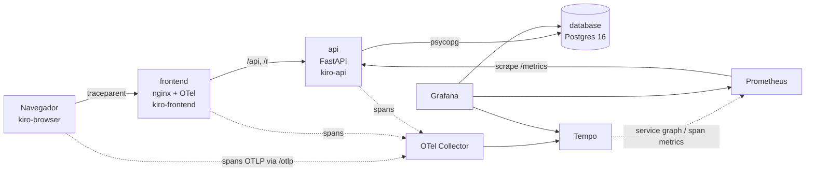

# Portal dos Links (Kiro Portal)

Encurtador de links cloud-native do hackathon CloudOps Bootcamp. A arquitetura é **Frontend → API → Postgres**, roda no Kubernetes, chega ao cluster pelo **GitHub Actions + ArgoCD (GitOps)** e é observada de ponta a ponta com **OpenTelemetry, Tempo, Prometheus e Grafana**.

> **Identidade (proposta, D-08, D-15 a D-17 no [SSOT](SSOT.md)):** o portal se chama **Foldway** e o mascote é o **Furl**, que dobra links longos até virarem origamis. A feature exclusiva é o **QR Code** de cada link curto, com o origami no centro e download em PNG; os acessos pelo QR aparecem no Grafana em `kiro_feature_used_total{feature="qrcode"}`. A base para outras features continua pronta: cada clique fica em `click_events` (user agent e referer), há o ranking do "link do dia" e a série de cliques por hora.

## Arquitetura



- **frontend:** o Foldway (React 19 + Vite), compilado numa imagem multi-stage e servido por um nginx que faz proxy de `/api` e `/r` para a API. Por ser a mesma origem, não precisa de CORS. O navegador inicia o trace (`kiro-browser`) e o módulo OTel do nginx o continua. Quando um link não existe ou expirou, o nginx entrega a tela do Furl mantendo o 404/410. Detalhes em [frontend/README.md](frontend/README.md).
- **api:** Python 3.12, FastAPI e psycopg 3. Cria, lista, mostra estatísticas e redireciona links, contando cliques. Expõe `/healthz`, `/readyz` e `/metrics`.
- **database:** um StatefulSet do Postgres 16 com PVC. A própria API aplica o schema (`api/app/schema.sql`), de forma idempotente e com `pg_advisory_lock`.

## Estrutura

```
api/                 API (app/, tests/, Dockerfile)
frontend/            Foldway: React/Vite (src/), nginx.conf e Dockerfile multi-stage
k8s/                 kustomize: app + observabilidade (ponto de entrada do ArgoCD)
  observability/     Collector, Tempo, Prometheus, Grafana, configs e dashboard
argocd/              Application do ArgoCD
.github/workflows/   ci-cd.yaml (testes API/frontend -> validação -> build/push GHCR -> commit da tag)
scripts/             gerar-trafego.sh (demo) e kind-up.sh (cluster local)
docs/                kiro-log.md (uso de IA), otel-metrics-spec.md (contrato de telemetria)
openapi.yaml         contrato da API
SSOT.md              escopo, requisitos e decisões do grupo
```

## Como rodar

### 1. Na sua máquina (Docker Compose): o jeito mais rápido

Funciona em Windows, macOS e Linux. Só é preciso ter instalado:

- **Git**
- **Docker** com o Compose v2: [Docker Desktop](https://www.docker.com/products/docker-desktop/) no Windows/macOS, ou Docker Engine + plugin `docker compose` no Linux. Deixe o Docker aberto e rodando.
- Cerca de **4 GB de RAM livres** e as portas **3000, 3001, 8080 e 9090** livres.
- **Opcional, só para rodar no Kubernetes local (seção 3):** **kind** e **kubectl**. O passo a passo de instalação está na própria seção 3.

Não é preciso instalar Node, Python nem Postgres: tudo roda em containers.

```bash
git clone https://github.com/JosephLMedeiros/rascunho-encurtador.git
cd rascunho-encurtador
docker compose up --build -d      # a primeira vez leva alguns minutos (baixa e builda as imagens)
docker compose ps                 # espere a api aparecer como "healthy"
```

Abra **http://localhost:3000**, cole um link longo e clique em **Encurtar**. O link curto aparece com o QR Code ao lado; o botão **QR Code** de cada item da lista mostra o QR daquele link.

Para parar: `docker compose down` (os links ficam salvos no volume do Postgres). Para começar do zero: `docker compose down -v`.

Se algo der errado:

- **"port is already allocated":** outra aplicação usa uma das portas acima. Feche-a ou troque o lado esquerdo do `ports` no `docker-compose.yml` (ex.: `"3005:8080"`).
- **A página abre mas a lista dá erro:** a API ainda está subindo. Veja `docker compose logs api` e aguarde o `healthy`.
- **QR Code lido pelo celular não abre:** os links usam `http://localhost:3000`, que só existe no seu computador. Para testar no celular, troque `BASE_URL` no `docker-compose.yml` pelo IP da máquina na rede (ex.: `http://192.168.0.10:3000`) e rode `docker compose up -d` de novo.

O que fica disponível:

| O quê | Onde |
|---|---|
| App (frontend) | http://localhost:3000 |
| API direta | http://localhost:8080 (documentação em `/docs`) |
| Grafana | http://localhost:3001 (abre direto no dashboard; admin / `troque-esta-senha`) |
| Prometheus | http://localhost:9090 |

Para testar sem o navegador, você pode usar a API pelo terminal. O `curl` é uma ferramenta que faz requisições HTTP:

1. **O primeiro `curl` cria um link curto**, o mesmo que o botão **Encurtar** do site. Ele pede ao portal para criar `localhost:3000/r/meu-portal` apontando para `https://example.com`. O `custom_code` é o código escolhido (sem ele, a API gera um aleatório). Se rodar o comando duas vezes, a segunda devolve **409**, porque o código já existe: para repetir, troque o `custom_code`.

2. **O segundo `curl` acessa o link curto**, como um visitante. O `-i` mostra os cabeçalhos da resposta: o esperado é `302 Found` com `location: https://example.com`, e o clique é contado. Um código que não existe devolve `404`.

3. **O script gera tráfego** por 120 segundos, para os painéis do Grafana terem dados.


```bash
curl -X POST localhost:3000/api/links -H 'content-type: application/json' \
  -d '{"original_url":"https://example.com","custom_code":"meu-portal"}'
curl -i localhost:3000/r/meu-portal          # 302 -> destino, conta o clique
scripts/gerar-trafego.sh http://localhost:3000 120
```

```bash
curl -X POST localhost:3000/api/links -H 'content-type: application/json' \
  -d '{"original_url":"https://example.com","custom_code":"meu-portal"}'
curl -i localhost:3000/r/meu-portal          # 302 -> destino, conta o clique
scripts/gerar-trafego.sh http://localhost:3000 120
```

### 2. Desenvolvimento e testes

Frontend com recarga automática (precisa de Node.js 22); a API continua no Docker:

```bash
docker compose up -d api
cd frontend
npm install
npm run dev        # http://localhost:5173
npm test           # testes do frontend; também há npm run lint e npm run lint:css
```


Testes da API. O jeito mais simples não exige instalar Python nem Postgres, só o Docker (igual em Linux, macOS e Windows). Rode da **raiz do projeto**:

```bash
docker compose --profile test run --rm api-test
docker compose --profile test down      # remove o banco de teste ao terminar
```

O comando sobe um Postgres descartável (`test-db`), espera ele ficar pronto, roda o pytest com Python 3.12 e apaga o container dos testes. A aplicação não precisa estar rodando, e os outros serviços não sobem. Os serviços de teste ficam no profile `test`, então o `docker compose up` normal os ignora.

> **Atenção:** use `run api-test`, e não `docker compose --profile test up`, que sobe a aplicação inteira junto com os testes.

São 44 testes, entre unitários e de integração com Postgres real. Eles cobrem a criação, os conflitos (409), as validações (400), a paginação, o redirect (302, 404 e 410), a contagem de cliques, o ranking, o banco fora do ar (503) e o **contrato de telemetria** (nomes das métricas, `http_route` como template e o span do banco como filho do span HTTP).

<details>
<summary>Alternativa sem Docker (Python local)</summary>

Precisa de **Python 3.12** (confira com `python3 --version`; versões diferentes podem se comportar de outro jeito) e de um Postgres de teste:

```bash
docker run -d --name kiro-test-db -e POSTGRES_USER=kiro -e POSTGRES_PASSWORD=kiro \
  -e POSTGRES_DB=kiro_test -p 5433:5432 postgres:16-alpine
cd api
python3 -m venv .venv && . .venv/bin/activate     # Windows: .venv\Scripts\activate
pip install -r requirements-dev.txt
pytest                                            # usa TEST_DATABASE_URL (padrão: localhost:5433)
docker rm -f kiro-test-db                         # remove o banco de teste ao terminar
```
</details>

### 3. Kubernetes local com kind (plano B da demo)

```bash
scripts/kind-up.sh
kubectl -n encurtador port-forward svc/frontend 3000:80
kubectl -n encurtador port-forward svc/grafana 3001:3000
```

### 3. Kubernetes local com kind (plano B da demo)

O **kind** (Kubernetes IN Docker) cria um cluster Kubernetes dentro de containers Docker. Ele sobe a mesma aplicação do Docker Compose, mas operada como num cluster de verdade: 2 réplicas da API e do frontend, StatefulSet para o Postgres, probes de saúde etc.

> O Compose e o kind são **ambientes independentes** e disputam as portas 3000 e 3001 e a memória. **Pare o Compose antes** (`docker compose down`).

#### Passo 1: instalar o kind e o kubectl (uma única vez)

O **kind** cria o cluster e o **kubectl** é a ferramenta para conversar com ele. O Docker precisa estar instalado e aberto (veja os pré-requisitos).

**Linux (x86_64):**

```bash
# kind
curl -Lo ./kind https://kind.sigs.k8s.io/dl/latest/kind-linux-amd64
chmod +x ./kind
sudo mv ./kind /usr/local/bin/kind

# kubectl
curl -LO "https://dl.k8s.io/release/$(curl -L -s https://dl.k8s.io/release/stable.txt)/bin/linux/amd64/kubectl"
chmod +x kubectl
sudo mv kubectl /usr/local/bin/kubectl
```

Em máquinas ARM (por exemplo, uma VM em Mac com chip Apple), troque `amd64` por `arm64`. Para saber a sua arquitetura, rode `uname -m` (`x86_64` = amd64, `aarch64` = arm64).

**macOS (Homebrew):**

```bash
brew install kind kubectl
```

**Windows (PowerShell):**

```powershell
winget install Kubernetes.kind
winget install Kubernetes.kubectl
```

Feche e abra o terminal depois de instalar. No Windows, os scripts `.sh` do projeto precisam de um terminal bash: use o **WSL** ou o **Git Bash**.

Confirme que as duas ferramentas foram instaladas:

```bash
kind version
kubectl version --client
```

> As instruções de Linux são as que foram usadas nos testes. As de macOS e Windows seguem a documentação oficial do [kind](https://kind.sigs.k8s.io/docs/user/quick-start/#installation) e do [kubectl](https://kubernetes.io/docs/tasks/tools/), e podem variar com a versão do gerenciador de pacotes.

#### Passo 2: subir o cluster

Da **raiz do projeto**:

```bash
scripts/kind-up.sh
```

O script cria o cluster `kiro`, builda as imagens da API e do frontend localmente, carrega-as no cluster e aplica os manifests de `k8s/`. A primeira vez demora alguns minutos. Se aparecer `Permission denied`, o clone é antigo e o script está sem permissão de execução: rode `chmod +x scripts/*.sh` ou `bash scripts/kind-up.sh`.

Quando terminar, confira se todos os pods estão `Running` e `READY` (ex.: `1/1`):

```bash
kubectl -n encurtador get pods
```

#### Passo 3: abrir o app e o Grafana

Dentro do cluster, os serviços só têm endereço interno. O `kubectl port-forward` faz a ponte para o seu computador:

```bash
kubectl -n encurtador port-forward svc/frontend 3000:80      # app em http://localhost:3000
kubectl -n encurtador port-forward svc/grafana 3001:3000     # Grafana em http://localhost:3001
```

- **Sem o `port-forward`, o site e o Grafana não abrem**, mesmo com tudo rodando no cluster.
- Cada comando **ocupa o terminal** e precisa continuar rodando: use **um terminal por serviço**. Ctrl+C derruba a ponte, mas o cluster continua de pé.
- Se o site parar de responder depois de um deploy, o pod por trás da conexão pode ter sido trocado: rode o comando de novo.
- Para o Prometheus, use um terceiro terminal: `kubectl -n encurtador port-forward svc/prometheus 9090:9090` (confirme o nome e a porta com `kubectl -n encurtador get svc`).

No Grafana, o painel "Pods da API no ar" deve mostrar **2**, e no Prometheus o `up{app="api"}` terá uma série por pod.

#### Para apagar o cluster

```bash
kind delete cluster --name kiro
kind get clusters                 # não deve mais listar "kiro"
```

Isso remove o cluster inteiro, incluindo o Postgres e o ArgoCD instalados nele. Encerre antes os `port-forward` (Ctrl+C).

#### Se algo der errado

| Sintoma | Causa provável | O que fazer |
|---|---|---|
| `kind: command not found` ou `kubectl: command not found` | Ferramenta não instalada | Faça o passo 1 |
| `Permission denied` ao rodar o script | Clone antigo, sem permissão de execução | `chmod +x scripts/*.sh` |
| Pod em `Pending` ou `CrashLoopBackOff` | Falta de memória, ou o cluster ainda está subindo | Libere memória (`docker compose down`) e acompanhe com `kubectl -n encurtador get pods -w` |
| `port is already allocated` ou `address already in use` | O Compose ou outro `port-forward` está usando a porta | `docker compose down` e feche os `port-forward` antigos |
| Site e Grafana não abrem | `port-forward` não está rodando | Rode os comandos do passo 3 |

### 4. Cluster com GitOps (ArgoCD)

1. Um push na `main` dispara o `.github/workflows/ci-cd.yaml`: ele roda o pytest e o lint, os testes e o build do frontend, valida os manifests com kubeconform, builda as imagens e as publica em `ghcr.io/<owner>/<repo>/{api,frontend}:<sha>`, e depois **commita a nova tag** em `k8s/kustomization.yaml`.
2. Instale o ArgoCD e registre a Application, uma única vez, com o `kubectl` apontando para o cluster (no kind: depois do `scripts/kind-up.sh`):
   ```bash
   scripts/argocd-up.sh
   ```
   O script instala o ArgoCD **v3.5.5** (versão fixa), aplica `argocd/application.yaml`, espera a primeira sincronização e mostra a senha do `admin`. Pode ser rodado de novo sem problema.
3. A partir daí, tudo chega pelo Git. O ArgoCD consulta a `main` a cada ~3 minutos e sincroniza `k8s/` com `prune` (remove o que saiu do Git) e `selfHeal` (desfaz alterações feitas na mão no cluster).

Para acompanhar pela interface:

```bash
kubectl -n argocd port-forward svc/argocd-server 8443:443   # https://localhost:8443 (admin)
kubectl -n argocd get secret argocd-initial-admin-secret -o jsonpath='{.data.password}' | base64 -d
kubectl -n encurtador port-forward svc/frontend 3000:80      # o app servido pelo cluster
```

**Roteiro de demo do GitOps:**
- **Deploy:** faça um merge na `main` e mostre o pipeline publicando as imagens, o commit `deploy: ...` do bot e o ArgoCD trocando os pods para a nova tag.
- **Self-heal:** rode `kubectl -n encurtador scale deploy/api --replicas=5` e mostre o ArgoCD voltando para 2 réplicas em segundos, porque o Git é a fonte da verdade.

Pré-requisitos e pontos de atenção:
- As imagens no GHCR (`api` e `frontend`) estão **públicas**, então o cluster não precisa de credencial. Num fork, os pacotes nascem privados: torne-os públicos ou configure um `imagePullSecret`.
- O cluster precisa de uma StorageClass padrão para o PVC do Postgres.
- As senhas em `k8s/database/secret.yaml` e `k8s/observability/grafana.yaml` são **exemplos ("troque-esta-senha")**. Os próprios arquivos explicam como usar um Secret real fora do Git.
- Se houver um Ingress Controller, habilite `k8s/base/ingress.yaml` no kustomization e ajuste o `BASE_URL`.

## API

| Método | Rota | Descrição |
|---|---|---|
| POST | `/api/links` | `{original_url, custom_code?, expires_at?}` → 201. Retorna 409 se o código já existir e 400 se a entrada for inválida |
| GET | `/api/links?limit&offset` | `{total, items}`, com os mais recentes primeiro |
| GET | `/api/links/{code}/stats` | Dados do link e `last_24h` (cliques por hora) |
| GET | `/api/ranking?hours&limit` | Ranking do "link do dia" |
| GET | `/r/{code}` (e `/{code}`) | 302 para o destino e conta o clique. Retorna 404 se não existir e 410 se tiver expirado |
| GET | `/healthz` · `/readyz` · `/metrics` | Liveness · readiness (banco) · Prometheus |

O contrato completo está em [openapi.yaml](openapi.yaml), e a API também serve `/docs`.

## Kubernetes

| Recurso | Uso |
|---|---|
| Deployments | api (2 réplicas), frontend (2), otel-collector, tempo, prometheus, grafana |
| StatefulSet e PVC | Postgres |
| Services | `api:8080`, `frontend:80`, `database:5432` e os da observabilidade |
| ConfigMap | `api-config` (banco, BASE_URL, OTEL_*), além das configs de observabilidade geradas por `configMapGenerator` |
| Secrets | `db-credentials`, `grafana-admin` |
| Probes | API: startup e liveness em `/healthz`, readiness em `/readyz`; Postgres: `pg_isready`; nginx: `/healthz` |
| RBAC | ServiceAccount e Role para o Prometheus descobrir os pods |

Comportamento validado num cluster kind:
- Com o banco desligado, os pods da API saem do balanceamento (readiness) **sem reiniciar** (liveness), e voltam sozinhos quando o banco retorna.
- Os dados sobrevivem à recriação do pod do Postgres.
- O rollout acontece sem downtime.

## Observabilidade

O contrato está em [docs/otel-metrics-spec.md](docs/otel-metrics-spec.md).

- **Traces:** o caminho é navegador (`kiro-browser`) → nginx (`kiro-frontend`) → API (`kiro-api`) → Postgres, com propagação W3C `traceparent`. O log de acesso do nginx traz o `trace_id`. As probes não geram traces.
- **Métricas da API (`/metrics`):**
  - `kiro_link_clicks_total`
  - `kiro_links_created_total{kind}`
  - `kiro_link_redirect_duration_seconds{outcome}`
  - `kiro_active_links`
  - `kiro_feature_used_total{feature}` (`stats`, `ranking` e `qrcode`)
  - `http_server_request_duration_seconds{http_route,...}`
- **Dashboard "Kiro Portal - Visão geral"** (provisionado automaticamente):
  - cliques/s e cliques na última hora;
  - latência p50, p95 e p99 do redirect;
  - taxa de erros 5xx e respostas por status;
  - requisições e latência por rota;
  - resultado dos redirects (found, not_found, expired);
  - links ativos e criados;
  - uso de features;
  - **link do dia** (SQL no Postgres);
  - spans por componente e **traces recentes** com link para o trace no Tempo.

**Roteiro da demo:**

1. Rode `scripts/gerar-trafego.sh http://localhost:3000 120` e mostre os painéis subindo. O Grafana abre como visitante, sem login.
2. Para abrir um trace, clique em **Sign in** e entre com `admin` / `troque-esta-senha`. Sem o login, o clique no Trace ID só recarrega a página.
3. No painel inferior direito, clique num Trace ID em "Traces recentes" para mostrar o trace atravessando frontend → API → banco.

> O span `kiro-browser` só aparece em ações feitas pelo site (criar e listar links). Redirects abertos na barra de endereço, `curl` ou o script de tráfego começam no `kiro-frontend`. Para ver a cadeia completa, crie um link pelo site.

## Decisões técnicas (resumo)

| Decisão | Por quê |
|---|---|
| Python, FastAPI e psycopg 3 (D-03) | Validação e OpenAPI nativos, instrumentação OTel oficial para FastAPI e psycopg e testes simples com pytest |
| Postgres e schema aplicado pela API com advisory lock (D-05) | Funciona igual no compose e no cluster, e duas réplicas não migram ao mesmo tempo |
| Clique e evento num único statement (CTE) | O contador e o log de cliques nunca divergem, com uma ida ao banco por redirect |
| `synchronous_commit off` só no clique | Os traces mostraram picos de até 1s causados pelo fsync. O pior caso caiu para cerca de 12 ms; perde-se no máximo uma fração de segundo de cliques num crash, e a criação de links continua durável |
| Redirect em `/r/{code}` (D-06) | Não conflita com as rotas do frontend; `/{code}` continua aceito por compatibilidade |
| nginx fazendo proxy na mesma origem (D-13) | Sem CORS, e o frontend vira um elo do trace |
| 404/410 de `/r/` interceptados pelo nginx (D-12) | O visitante vê a tela do Furl em vez de um JSON, e o status HTTP continua correto |
| QR Code gerado no navegador, apontando para `?via=qr` (D-17) | Nenhum endpoint novo; o visual segue o tema e a API mede os acessos vindos do QR |
| Kustomize com `images` e um único pipeline (D-07, D-10 GHCR) | O CI muda só a tag num commit e o ArgoCD aplica. Um único job de deploy evita pushes concorrentes |
| `/metrics` com scrape por pod (`kubernetes_sd`) | Cada réplica é um alvo, e `up{app="api"}` mostra a saúde |
| Configs de observabilidade compartilhadas | Os mesmos arquivos geram os ConfigMaps (com hash, o que reinicia o pod quando a config muda) e são montados pelo compose |
| Ranking a partir do Postgres | `short_code` em label do Prometheus geraria alta cardinalidade |

## Como a IA foi usada

O enunciado avalia o uso do **Kiro**. A equipe trabalha com Spec-Driven Development (specs em `.kiro/specs/`, regras em `.kiro/steering/` e o registro em [docs/kiro-log.md](docs/kiro-log.md)).

A implementação em Python (API, manifests, pipeline e observabilidade) foi feita com o assistente **Claude Code**, sob revisão humana, a partir dos contratos que a equipe produziu com o Kiro: `openapi.yaml`, o schema e o `otel-metrics-spec.md`. Em vários pontos a IA errou ou encontrou problemas, e as correções aparecem no histórico de commits:
- um bug que só aparecia no Python 3.12;
- o `startupProbe` matando a API no primeiro boot;
- traces poluídos pelas probes;
- picos de latência por fsync.

Os prompts, as decisões e as revisões estão em [docs/kiro-log.md](docs/kiro-log.md).
