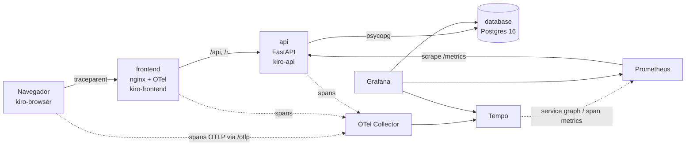

# Portal dos Links (Kiro Portal)

Encurtador de links cloud-native do hackathon CloudOps Bootcamp. A arquitetura é **Frontend → API → Postgres**, roda no Kubernetes, chega ao cluster pelo **GitHub Actions + ArgoCD (GitOps)** e é observada de ponta a ponta com **OpenTelemetry, Tempo, Prometheus e Grafana**.

> **Identidade (proposta, D-08, D-15 a D-17 no [SSOT](SSOT.md)):** o portal se chama **Foldway** e o mascote é o **Furl**, que dobra links longos até virarem origamis. A feature exclusiva é o **QR Code** de cada link curto, com o origami no centro e download em PNG; os acessos pelo QR aparecem no Grafana em `kiro_feature_used_total{feature="qrcode"}`. A base para outras features continua pronta: cada clique fica em `click_events` (user agent e referer), há o ranking do "link do dia" e a série de cliques por hora.

## Arquitetura



- **frontend:** o Foldway (React 19 + Vite), compilado numa imagem multi-stage e servido por um nginx que faz proxy de `/api` e `/r` para a API. Por ser a mesma origem, não precisa de CORS. O navegador inicia o trace (`kiro-browser`) e o módulo OTel do nginx o continua. Quando um link não existe ou expirou, o nginx entrega a tela do Furl mantendo o 404/410. Detalhes em [frontend/README.md](frontend/README.md).
- **api:** Python 3.12, FastAPI e psycopg 3. Cria, lista, mostra estatísticas e redireciona links, contando cliques. Expõe `/healthz`, `/readyz` e `/metrics`.
- **database:** um StatefulSet do Postgres 16 com PVC. A própria API aplica o schema (`api/app/schema.sql`), de forma idempotente e com `pg_advisory_lock`.

## Estrutura

```
api/                 API (app/, tests/, Dockerfile)
frontend/            Foldway: React/Vite (src/), nginx.conf e Dockerfile multi-stage
k8s/                 kustomize: app + observabilidade (ponto de entrada do ArgoCD)
  observability/     Collector, Tempo, Prometheus, Grafana, configs e dashboard
argocd/              Application do ArgoCD
.github/workflows/   ci-cd.yaml (testes API/frontend -> validação -> build/push GHCR -> commit da tag)
scripts/             gerar-trafego.sh (demo) e kind-up.sh (cluster local)
docs/                kiro-log.md (uso de IA), otel-metrics-spec.md (contrato de telemetria)
openapi.yaml         contrato da API
SSOT.md              escopo, requisitos e decisões do grupo
```

## Como rodar

### 1. Local com Docker Compose (app e observabilidade completa)

```bash
docker compose up --build
```

| O quê | Onde |
|---|---|
| App (frontend) | http://localhost:3000 |
| API direta | http://localhost:8080 (documentação em `/docs`) |
| Grafana | http://localhost:3001 (abre direto no dashboard; admin / `troque-esta-senha`) |
| Prometheus | http://localhost:9090 |

```bash
curl -X POST localhost:3000/api/links -H 'content-type: application/json' \
  -d '{"original_url":"https://example.com","custom_code":"meu-portal"}'
curl -i localhost:3000/r/meu-portal          # 302 -> destino, conta o clique
scripts/gerar-trafego.sh http://localhost:3000 120
```

### 2. Testes da API

```bash
docker run -d --name kiro-test-db -e POSTGRES_USER=kiro -e POSTGRES_PASSWORD=kiro \
  -e POSTGRES_DB=kiro_test -p 5433:5432 postgres:16-alpine
cd api
python -m venv .venv && . .venv/bin/activate     # Windows: .venv\Scripts\activate
pip install -r requirements-dev.txt
pytest                                            # usa TEST_DATABASE_URL (padrão: localhost:5433)
```

São 43 testes, entre unitários e de integração com Postgres real. Eles cobrem a criação, os conflitos (409), as validações (400), a paginação, o redirect (302, 404 e 410), a contagem de cliques, o ranking, o banco fora do ar (503) e o **contrato de telemetria** (nomes das métricas, `http_route` como template e o span do banco como filho do span HTTP).

### 3. Kubernetes local com kind (plano B da demo)

```bash
scripts/kind-up.sh
kubectl -n encurtador port-forward svc/frontend 3000:80
kubectl -n encurtador port-forward svc/grafana 3001:3000
```

### 4. Cluster com GitOps (ArgoCD)

1. Um push na `main` dispara o `.github/workflows/ci-cd.yaml`: ele roda o pytest e o lint, os testes e o build do frontend, valida os manifests com kubeconform, builda as imagens e as publica em `ghcr.io/<owner>/<repo>/{api,frontend}:<sha>`, e depois **commita a nova tag** em `k8s/kustomization.yaml`.
2. Instale o ArgoCD e aplique a Application uma única vez:
   ```bash
   kubectl create namespace argocd
   kubectl apply -n argocd -f https://raw.githubusercontent.com/argoproj/argo-cd/stable/manifests/install.yaml
   kubectl apply -n argocd -f argocd/application.yaml
   ```
3. A partir daí, tudo chega pelo Git. O ArgoCD sincroniza `k8s/` com `prune` e `selfHeal`.

Pré-requisitos e pontos de atenção:
- Os pacotes do GHCR nascem **privados**. Torne-os públicos ou configure um `imagePullSecret`.
- O cluster precisa de uma StorageClass padrão para o PVC do Postgres.
- As senhas em `k8s/database/secret.yaml` e `k8s/observability/grafana.yaml` são **exemplos ("troque-esta-senha")**. Os próprios arquivos explicam como usar um Secret real fora do Git.
- Se houver um Ingress Controller, habilite `k8s/base/ingress.yaml` no kustomization e ajuste o `BASE_URL`.

## API

| Método | Rota | Descrição |
|---|---|---|
| POST | `/api/links` | `{original_url, custom_code?, expires_at?}` → 201. Retorna 409 se o código já existir e 400 se a entrada for inválida |
| GET | `/api/links?limit&offset` | `{total, items}`, com os mais recentes primeiro |
| GET | `/api/links/{code}/stats` | Dados do link e `last_24h` (cliques por hora) |
| GET | `/api/ranking?hours&limit` | Ranking do "link do dia" |
| GET | `/r/{code}` (e `/{code}`) | 302 para o destino e conta o clique. Retorna 404 se não existir e 410 se tiver expirado |
| GET | `/healthz` · `/readyz` · `/metrics` | Liveness · readiness (banco) · Prometheus |

O contrato completo está em [openapi.yaml](openapi.yaml), e a API também serve `/docs`.

## Kubernetes

| Recurso | Uso |
|---|---|
| Deployments | api (2 réplicas), frontend (2), otel-collector, tempo, prometheus, grafana |
| StatefulSet e PVC | Postgres |
| Services | `api:8080`, `frontend:80`, `database:5432` e os da observabilidade |
| ConfigMap | `api-config` (banco, BASE_URL, OTEL_*), além das configs de observabilidade geradas por `configMapGenerator` |
| Secrets | `db-credentials`, `grafana-admin` |
| Probes | API: startup e liveness em `/healthz`, readiness em `/readyz`; Postgres: `pg_isready`; nginx: `/healthz` |
| RBAC | ServiceAccount e Role para o Prometheus descobrir os pods |

Comportamento validado num cluster kind:
- Com o banco desligado, os pods da API saem do balanceamento (readiness) **sem reiniciar** (liveness), e voltam sozinhos quando o banco retorna.
- Os dados sobrevivem à recriação do pod do Postgres.
- O rollout acontece sem downtime.

## Observabilidade

O contrato está em [docs/otel-metrics-spec.md](docs/otel-metrics-spec.md).

- **Traces:** o caminho é navegador (`kiro-browser`) → nginx (`kiro-frontend`) → API (`kiro-api`) → Postgres, com propagação W3C `traceparent`. O log de acesso do nginx traz o `trace_id`. As probes não geram traces.
- **Métricas da API (`/metrics`):**
  - `kiro_link_clicks_total`
  - `kiro_links_created_total{kind}`
  - `kiro_link_redirect_duration_seconds{outcome}`
  - `kiro_active_links`
  - `kiro_feature_used_total{feature}` (`stats`, `ranking` e `qrcode`)
  - `http_server_request_duration_seconds{http_route,...}`
- **Dashboard "Kiro Portal - Visão geral"** (provisionado automaticamente):
  - cliques/s e cliques na última hora;
  - latência p50, p95 e p99 do redirect;
  - taxa de erros 5xx e respostas por status;
  - requisições e latência por rota;
  - resultado dos redirects (found, not_found, expired);
  - links ativos e criados;
  - uso de features;
  - **link do dia** (SQL no Postgres);
  - spans por componente e **traces recentes** com link para o trace no Tempo.

**Roteiro da demo:** rode `scripts/gerar-trafego.sh` e mostre os painéis subindo. Depois clique num Trace ID em "Traces recentes" para mostrar o trace atravessando frontend → API → banco.

## Decisões técnicas (resumo)

| Decisão | Por quê |
|---|---|
| Python, FastAPI e psycopg 3 (D-03) | Validação e OpenAPI nativos, instrumentação OTel oficial para FastAPI e psycopg e testes simples com pytest |
| Postgres e schema aplicado pela API com advisory lock (D-05) | Funciona igual no compose e no cluster, e duas réplicas não migram ao mesmo tempo |
| Clique e evento num único statement (CTE) | O contador e o log de cliques nunca divergem, com uma ida ao banco por redirect |
| `synchronous_commit off` só no clique | Os traces mostraram picos de até 1s causados pelo fsync. O pior caso caiu para cerca de 12 ms; perde-se no máximo uma fração de segundo de cliques num crash, e a criação de links continua durável |
| Redirect em `/r/{code}` (D-06) | Não conflita com as rotas do frontend; `/{code}` continua aceito por compatibilidade |
| nginx fazendo proxy na mesma origem (D-13) | Sem CORS, e o frontend vira um elo do trace |
| 404/410 de `/r/` interceptados pelo nginx (D-12) | O visitante vê a tela do Furl em vez de um JSON, e o status HTTP continua correto |
| QR Code gerado no navegador, apontando para `?via=qr` (D-17) | Nenhum endpoint novo; o visual segue o tema e a API mede os acessos vindos do QR |
| Kustomize com `images` e um único pipeline (D-07, D-10 GHCR) | O CI muda só a tag num commit e o ArgoCD aplica. Um único job de deploy evita pushes concorrentes |
| `/metrics` com scrape por pod (`kubernetes_sd`) | Cada réplica é um alvo, e `up{app="api"}` mostra a saúde |
| Configs de observabilidade compartilhadas | Os mesmos arquivos geram os ConfigMaps (com hash, o que reinicia o pod quando a config muda) e são montados pelo compose |
| Ranking a partir do Postgres | `short_code` em label do Prometheus geraria alta cardinalidade |

## Como a IA foi usada

O enunciado avalia o uso do **Kiro**. A equipe trabalha com Spec-Driven Development (specs em `.kiro/specs/`, regras em `.kiro/steering/` e o registro em [docs/kiro-log.md](docs/kiro-log.md)).

A implementação em Python (API, manifests, pipeline e observabilidade) foi feita com o assistente **Claude Code**, sob revisão humana, a partir dos contratos que a equipe produziu com o Kiro: `openapi.yaml`, o schema e o `otel-metrics-spec.md`. Em vários pontos a IA errou ou encontrou problemas, e as correções aparecem no histórico de commits:
- um bug que só aparecia no Python 3.12;
- o `startupProbe` matando a API no primeiro boot;
- traces poluídos pelas probes;
- picos de latência por fsync.

Os prompts, as decisões e as revisões estão em [docs/kiro-log.md](docs/kiro-log.md).
